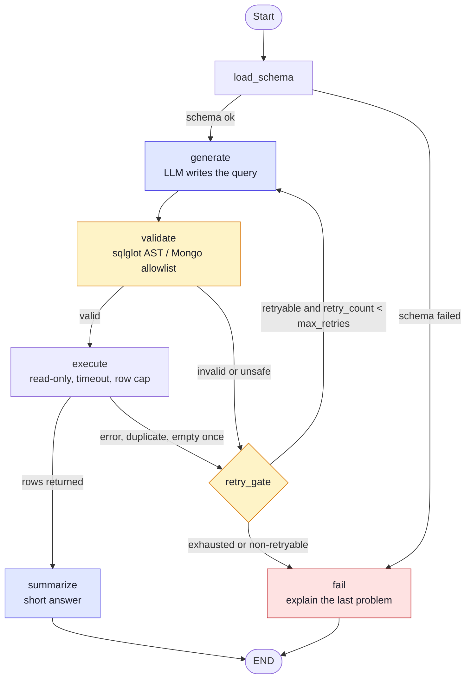

# Agent Flow

## Agentic graph



Blue nodes call the LLM, amber nodes are deterministic guards, red is the failure exit. `retry_gate` is the only place `retry_count` changes, so the loop is bounded by `AGENT_MAX_RETRIES` (default 3).

## Text view

```
load_schema → generate → validate → execute → summarize → END
                 ▲           │          │
                 │           ▼          ▼
                 └──────── retry_gate ◄─┘ ──(exhausted / non-retryable)──► fail → END
```
Code: [`agent/graph.py`](../backend/app/agent/graph.py), [`agent/nodes.py`](../backend/app/agent/nodes.py).

## Why a graph, not a free-form agent
Control flow is code, the LLM only fills nodes. This gives a hard retry cap, a validator that cannot be skipped, typed state, and per-node events for streaming and tests.

## Retry rules
- `AGENT_MAX_RETRIES` (default 3, max 5) = corrections after the first try, so at most **4 generations**.
- The counter lives in graph state and is incremented only by `retry_gate`.

| Failure | Retried? | Notes |
|---|---|---|
| Parse error / not a single statement | Yes | error fed back to the LLM |
| Execution error (unknown column, syntax, timeout) | Yes | sanitized driver message fed back |
| Duplicate of an earlier attempt | Yes | detected by normalized hash, counts as an attempt |
| Empty result | Once | likely wrong filter or join; accepted if it stays empty |
| Security violation (write, forbidden operator) | **No** | refused, not "fixed" |
| Connection / schema load failure | **No** | retrying the LLM cannot help |
| LLM or run deadline timeout | No | run ends with a clear message |

Each retry prompt contains the question, schema, and every prior failed query with its error, with an instruction not to repeat them.

## State
`question, history, schema, query, attempts[], retry_count, failure, result, answer, status`.

`history` holds the last 6 messages. Successful assistant turns include the query that produced them (`[query used: ...]`), so follow-up questions can adapt the previous SQL.
An attempt is `{n, query, stage, error, duration_ms}` and is stored on the assistant message for the UI trace and for future evals.

## Backstops
`recursion_limit=60`, `RUN_DEADLINE_SECONDS=90` (`asyncio.timeout`), per-query timeout, 1000-row cap.
