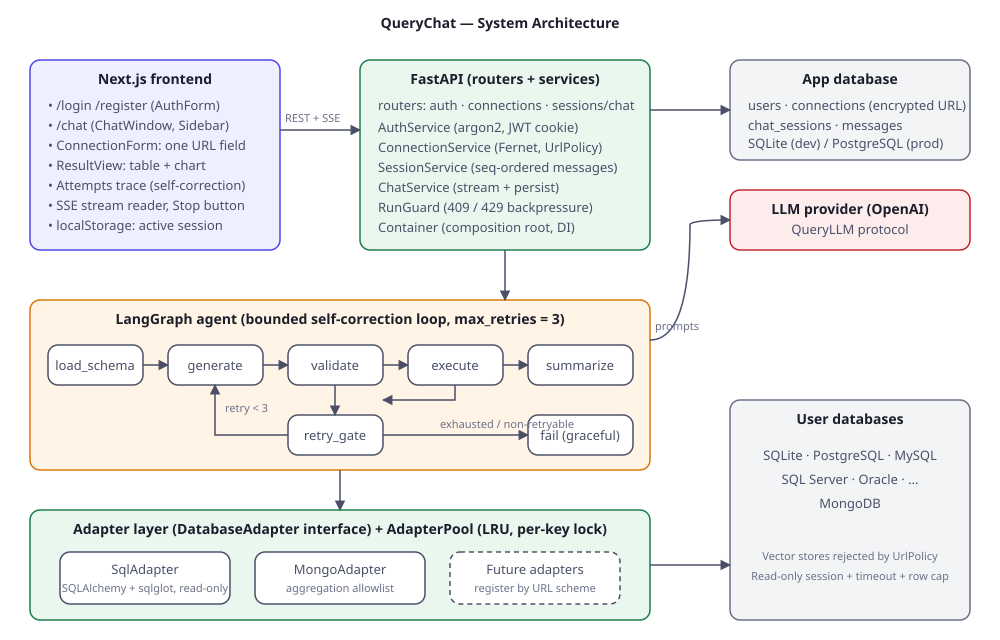
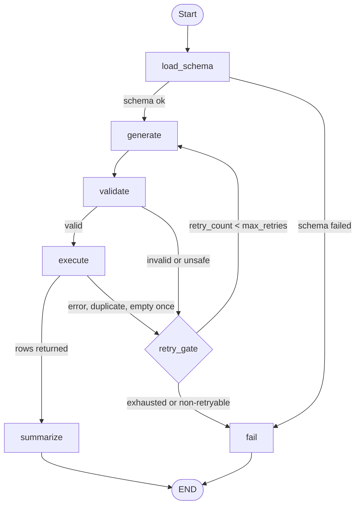

# QueryChat Architecture



QueryChat lets a signed-in user connect any non-vector database through **one URL field**, then ask questions in a chat UI. A LangGraph agent generates a read-only query, validates it, runs it, and **self-corrects up to 3 times** on failure.

## Documents
| File | Purpose |
|---|---|
| [agent-flow.md](./agent-flow.md) | Graph nodes, retry rules, state |
| [api.md](./api.md) | REST + SSE contract and data model |
| [security.md](./security.md) | Threat model and controls |
| [concurrency.md](./concurrency.md) | Concurrency and backpressure design |
| [suggestions.md](./suggestions.md) | Feature and optimization backlog |

## Repository layout
```
backend/app
  core/        config, errors, security primitives (hash, JWT, Fernet)
  db/          app-database ORM models
  adapters/    DatabaseAdapter ABC, SqlAdapter, MongoAdapter, registry, pool, UrlPolicy
  agent/       state, nodes, graph, events, LLM
  services/    auth, connection, session, chat, run_guard
  routers/     thin HTTP layer
  container.py composition root
frontend/src
  app/         login, register, chat pages
  components/  AuthForm, Sidebar, ConnectionForm, ChatWindow, MessageView, ResultView
  lib/         api client (+ SSE reader), types
```

## Layering
`routers → services → (adapters | agent | db)`. Routers only parse HTTP and call services. Services hold business rules. Adapters hide database specifics. Dependencies are wired in one place, [`container.py`](../backend/app/container.py).

## SOLID mapping
| Principle | Where |
|---|---|
| **S**ingle responsibility | One service per concern; each graph node does one job; `UrlPolicy` only judges URLs; `AdapterPool` only manages lifetimes |
| **O**pen/closed | New database family = new `DatabaseAdapter` + `registry.register(...)`; nothing else changes |
| **L**iskov | `SqlAdapter`, `MongoAdapter` and test `FakeAdapter` are interchangeable behind `DatabaseAdapter` |
| **I**nterface segregation | `QueryLLM` exposes only `generate_query` and `summarize`; adapters expose only what the agent needs |
| **D**ependency inversion | `AgentNodes` and `ChatService` depend on `DatabaseAdapter` / `QueryLLM` abstractions, injected by `Container` |

## OOP notes
- `DatabaseAdapter.get_schema` is a **template method**: caching and truncation in the base class, `_load_schema` in subclasses.
- `AdapterRegistry` is a **factory/registry**; `Container` is the **composition root**.
- Domain errors (`core/errors.py`) carry meaning; the agent reads them to decide retry vs stop, and `main.py` maps them to HTTP codes.

## Agentic graph

The chat agent is a LangGraph state machine with a bounded self-correction loop. Any retryable failure at validate or execute passes through `retry_gate` back to `generate`, with the error and earlier failed queries in the prompt. Security violations and connection failures go straight to `fail`.



Details, retry rules and state: [agent-flow.md](agent-flow.md).

## Request lifecycle (one chat turn)
1. Browser `POST /api/sessions/{id}/chat` (cookie auth, same-origin through the Next.js proxy).
2. `ChatService.prepare`: verify ownership, reserve a run slot (`RunGuard`), store the user message.
3. `AdapterPool.acquire`: reuse or open a connection to the user database.
4. Agent graph runs; each node update becomes an SSE event (`status`, `query`, `attempt_failed`, `retrying`).
5. Assistant message (answer, query, rows, attempts) is persisted; final `done` event is sent; run slot released.

## Known limits (v1)
- `RunGuard` and login throttling are in-process; use Redis for multi-worker deployments.
- Tables are created with `create_all`; adopt Alembic migrations before the first schema change in production.
- Access token only (12 h); no refresh-token rotation yet.
- Timed-out queries stop waiting but the driver thread may finish in the background; server-side cancel is a listed improvement.
